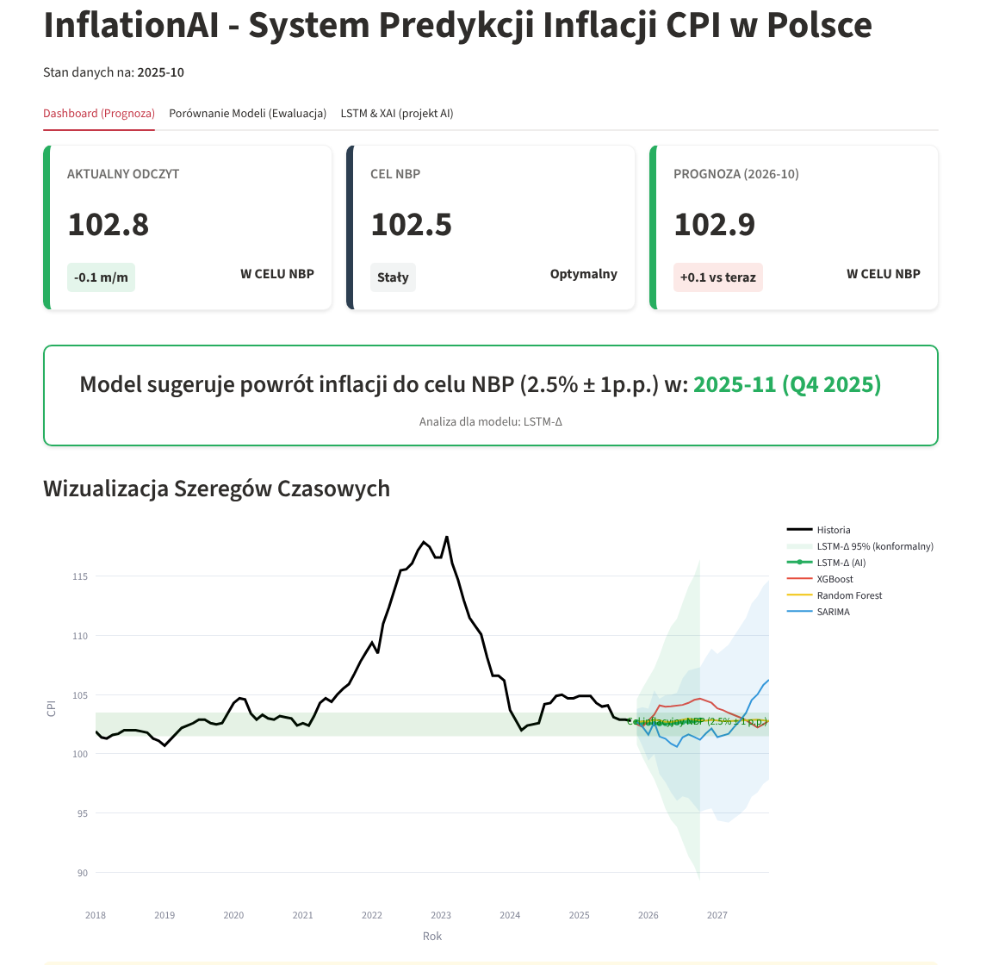

# InflationAI: prognozowanie inflacji CPI w Polsce

System do prognozowania inflacji konsumenckiej (CPI r/r) w Polsce, z aplikacją webową w Streamlit.
Projekt rozwija pracę inżynierską (SARIMA, XGBoost, Random Forest) o moduł AI: **sieć LSTM** z ujednoliconą
ewaluacją, warstwą **Explainable AI (XAI)** i oceną końcową na danych, których model nigdy nie widział.



## Najważniejsze funkcje

- **Dashboard**: prognoza CPI z kilku modeli z przedziałami 95%, karty KPI, komunikat o powrocie do celu NBP
  (2,5% ± 1 p.p.), symulacja szoku („what-if”), kalkulator siły nabywczej, eksport CSV / PDF / MATLAB.
- **Ewaluacja**: porównanie modeli na danych historycznych (MAE, RMSE, MAPE) i diagnostyka reszt SARIMA.
- **LSTM & XAI**:
  - prognoza sieci LSTM na 12 miesięcy z wyjaśnieniem, które miesiące historii wpłynęły na wynik,
  - wyniki eksperymentów i test Diebolda-Mariano,
  - mapy Integrated Gradients, porównanie z SHAP dla XGBoost,
  - analiza błędów i ocena końcowa na nowych danych.

## Wyniki w skrócie

MAE [p.p.], prognoza na 1 miesiąc naprzód, na trzech niezależnych okresach testowych:

| Model | Test A (2015–2025) | Test B (2023–2025) | Nowe dane (11.2025–10.2026) |
|---|---|---|---|
| Naive | 0,489 | 0,706 | 0,392 |
| SARIMA | 0,494 | 0,715 | 0,604 |
| XGBoost (model z pracy inżynierskiej) | 2,179 | 0,997 | 0,518 |
| LR-Δ (regresja liniowa na zmianach) | **0,407** | **0,584** | **0,352** |
| **LSTM-Δ (model finalny)** | 0,452 | 0,700 | 0,396 |

Wnioski:
- Prognozowanie **miesięcznych zmian** CPI zamiast poziomu usuwa limit ekstrapolacji modeli drzewiastych.
  W latach 2021–2023 błąd spada ok. 5-krotnie.
- LSTM-Δ jest istotnie lepszy od XGBoost w okresie zmiany reżimu.
- Przy ok. 300 obserwacjach nie daje istotnej przewagi nad prostymi modelami.

Szczegóły są w `results/hypotheses.md` oraz w zakładce „LSTM & XAI” aplikacji.

## Wymagania

- Python **3.10–3.13**
- ok. 1 GB miejsca na biblioteki (głównie PyTorch)
- system: macOS, Linux lub Windows

## Instalacja

```bash
git clone <adres-repozytorium>
cd inflation_forecast

python3 -m venv .venv
source .venv/bin/activate          # Windows: .venv\Scripts\activate
pip install --upgrade pip
pip install -r requirements.txt
```

## Uruchomienie aplikacji

Wszystkie wyniki są już w repozytorium, więc aplikacja działa od razu, bez trenowania modeli:

```bash
streamlit run app.py
```

Aplikacja otworzy się w przeglądarce pod adresem http://localhost:8501.

## Testy

```bash
python -m pytest -q test_app.py
```

Testy sprawdzają logikę pomocniczą (statusy inflacji, metryki, raport PDF), kompletność plików z danymi,
start aplikacji, działanie panelu bocznego oraz obecność wszystkich zakładek i wyników modułu AI.

## Przeliczenie wyników od zera

Cały pipeline jednym poleceniem:

```bash
python run_all.py
```

| Krok | Skrypt | Wynik | Czas |
|---|---|---|---|
| 1 | `data_source.py` | pobiera arkusz NBP → `cpi_data.csv` (bez internetu użyje `bazowa-2.xlsx`) | sekundy |
| 2 | `arima_auto.py` | SARIMA (AutoARIMA) → `sarima_10y_forecast.csv` | ok. 1 min |
| 3 | `ml_forecast_10y.py` | XGBoost i Random Forest → `ml_10y_forecast_combined.csv` | sekundy |
| 4 | `naive_forecast_10y.py` | benchmark naiwny → `naive_10y_forecast.csv` | sekundy |
| 5 | `generate_validation.py` | walidacja historyczna → `validation_data.csv` | ok. 1 min |
| 6 | `compare_forecasts.py` | wykres zbiorczy → `wykresy/` | sekundy |
| 7 | `experiments.py` | eksperymenty E1–E6 (LSTM vs modele bazowe) → `results/` | 3–10 min |
| 8 | `xai_lstm.py` | Integrated Gradients, okluzja, SHAP, analiza błędów → `results/xai/` | ok. 30 s |
| 9 | `lstm_forecast_future.py` | model finalny i prognoza 12 mies. → `lstm_forecast*.csv` | ok. 30 s |
| 10 | `final_evaluation.py` | ocena końcowa na nowych danych → `results/final/` | ok. 2 min |
| 11 | `report_figures.py` | wykresy do sprawozdań → `results/report_figures/` | sekundy |

Pojedyncze kroki można uruchamiać osobno, w tej samej kolejności. Szybki test eksperymentów:
`python experiments.py --quick`.

> **Uwaga o danych.** `data_source.py` pobiera **najnowszy** arkusz NBP. Wyniki w repozytorium są
> policzone na danych do 10.2025, więc po pobraniu nowszych danych liczby się zmienią. Analizę eksploracyjną
> (dekompozycja, ACF/PACF, testy ADF/KPSS) uruchamia się osobno: `python eda.py`.

## Struktura repozytorium

```
app.py, app_lstm_tab.py          aplikacja Streamlit
test_app.py                      testy (pytest)
run_all.py                       cały pipeline
requirements.txt

Dane
  bazowa-2.xlsx                  lokalna kopia arkusza NBP (fallback dla data_source.py)
  cpi_data.csv                   CPI r/r, 01.2001–10.2025
  holdout_cpi_2025-11_2026-10.csv  12 nowych odczytów GUS do oceny końcowej

Modele z pracy inżynierskiej
  data_source.py, data_loader.py   pobieranie i wczytywanie danych
  arima_auto.py, ml_forecast_10y.py, naive_forecast_10y.py, generate_validation.py, compare_forecasts.py
  eda.py                           analiza eksploracyjna
  *_10y_forecast*.csv, validation_data.csv   prognozy czytane przez aplikację

Moduł AI (LSTM + XAI)
  lstm_model.py                  sieć LSTM w PyTorch (warianty: poziom, Δ, Δ+kalendarz, multi-output)
  eval_utils.py                  protokół ewaluacji, metryki, test Diebolda-Mariano, modele bazowe
  experiments.py                 eksperymenty E1–E6
  xai_lstm.py                    warstwa XAI i analiza błędów
  lstm_forecast_future.py        model finalny (ensemble 5 sieci) i prognoza
  final_evaluation.py            ocena końcowa na danych 11.2025–10.2026
  report_figures.py              wykresy do sprawozdań
  lstm_forecast*.csv/json        prognoza i jej wyjaśnienie czytane przez aplikację

results/                         wyniki modułu AI: metryki, prognozy, testy, modele .pt, XAI, ocena końcowa
wykresy/                         wykresy generowane przez modele z pracy inżynierskiej
archiwum/                        skrypty badawcze z pracy inżynierskiej i ich wyniki (nieużywane przez aplikację)
```

Aplikacja czyta pliki CSV z głównego folderu oraz folder `results/`. Nie przenoś ich, bo aplikacja
przestanie działać.

## Metodologia (w skrócie)

- **Dane**: indeks CPI r/r (analogiczny miesiąc poprzedniego roku = 100), NBP/GUS, 01.2001–10.2025.
  Ocena końcowa: 12 kolejnych odczytów GUS (od 2026 r. klasyfikacja COICOP 2018).
- **Podziały chronologiczne**:
  - A: trening 2001–2014, test 2015–2025;
  - B: trening 2001–2022, test 2023–2025 (zmiana reżimu inflacji).
- **Ewaluacja**: prognozy z kroczącym punktem startowym dla horyzontów 1–12 miesięcy, metryki MAE, RMSE, MAPE,
  MASE i trafność kierunku, test Diebolda-Mariano, 5 ziaren losowych dla LSTM.
- **LSTM**: hiperparametry dobierane przeglądem siatki na walidacji (bez użycia zbioru testowego), early
  stopping, przedziały konformalne.
- **XAI**: Integrated Gradients z kontrolą zupełności, okluzja, TreeSHAP dla XGBoost, analiza błędów
  (podokresy, punkty zwrotne, ekstrapolacja, kalibracja niepewności).

## Autor

Jan Zięba, AGH, Informatyka Techniczna.
Projekt powstał w ramach pracy inżynierskiej oraz kursu „Sztuczna Inteligencja w Systemach Informatycznych”.
